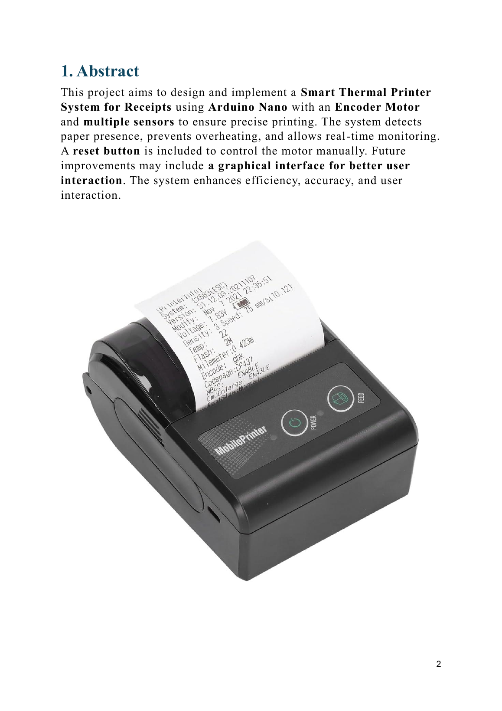
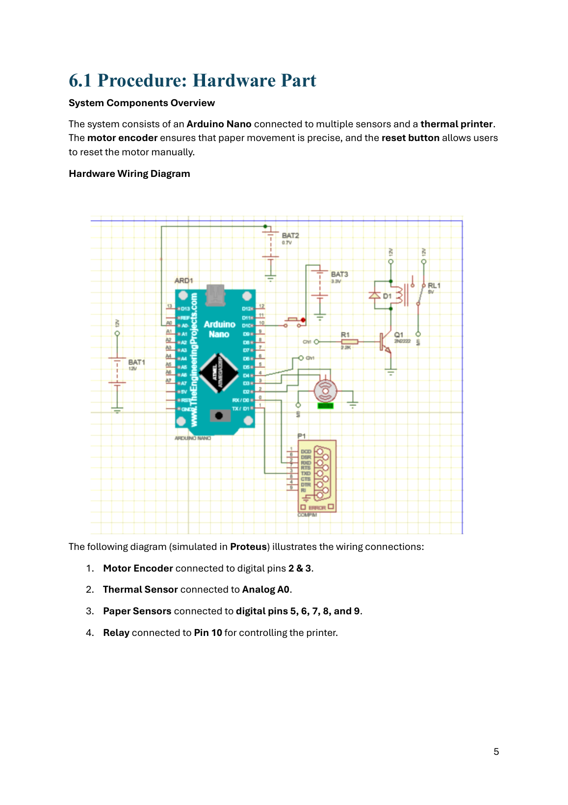
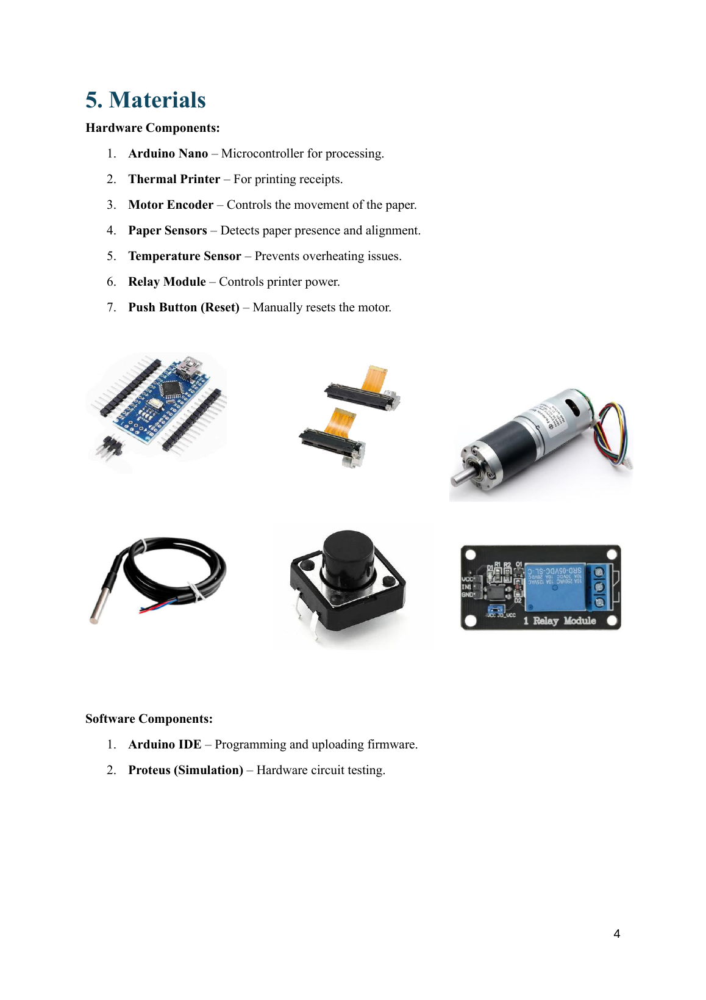

# Smart Thermal Printer System for Receipts

[](firmware/smart_thermal_printer/smart_thermal_printer.ino)
[](hardware/proteus/smart-thermal-printer.pdsprj)
[](#system-overview)

> An embedded receipt-printing prototype that combines encoder-based paper positioning, thermal-printer serial output, motor control, and sensor-aware operational checks.



## System overview

The system is built around an Arduino-compatible ATmega328P controller. It advances paper to a defined length using incremental encoder feedback, stops the feed motor, and then sends a formatted receipt over a serial interface to a thermal printer.

**Portfolio highlights**

- Measures paper travel from encoder pulses rather than relying only on timed motor control.
- Controls a paper-feed motor and stops automatically at the configured paper length.
- Sends itemized receipt content to a thermal printer through `SoftwareSerial`.
- Includes paper presence, end-of-paper, alignment, cover, thermal, and reset inputs in the hardware design.
- Provides a Proteus project and a detailed engineering report.

## Control sequence

```text
Reset / start
    -> feed paper motor
    -> count encoder pulses
    -> target length reached
    -> stop motor
    -> print receipt over UART
    -> restore feed state
```

## Hardware interface

| Function | Pin |
| --- | ---: |
| Encoder channel A / interrupt | D2 |
| Encoder channel B | D3 |
| Paper-feed motor control | D4 |
| Paper-present sensor | D5 |
| Paper-end sensor | D6 |
| Thermal sensor input | D7 |
| Paper-alignment sensor | D8 |
| Printer-cover sensor | D9 |
| Reset button | D10 |
| Thermal printer UART RX/TX | D11 / D12 |

The paper travel calculation uses a 2.5 cm wheel diameter, 240 encoder pulses per revolution, and a 10 cm target paper length.





## Repository layout

```text
.
├── firmware/smart_thermal_printer/     # Arduino sketch
├── hardware/proteus/                   # Proteus simulation project
└── docs/
    ├── assets/                         # Project visuals
    └── report/                         # Original academic report
```

## Run the firmware

1. Open `firmware/smart_thermal_printer/smart_thermal_printer.ino` in Arduino IDE.
2. Select an ATmega328P-based Arduino board and the correct serial port.
3. Confirm the motor driver, sensor wiring, and printer power supply before uploading.
4. Upload and monitor debug output at `9600` baud.

> The thermal printer has a separate power requirement. Validate voltage, current capacity, grounding, and driver protection before connecting physical hardware.

## Proteus simulation

Open `hardware/proteus/smart-thermal-printer.pdsprj` with Proteus. The project provides the simulation environment corresponding to the firmware and interface design.

For a detailed, text-first explanation of the sensing, movement, printing, and reset behaviour, see [System Architecture](docs/ARCHITECTURE.md).

## Project context

| Field | Details |
| --- | --- |
| Course area | Sensors and Embedded Systems |
| Institution | Islamic University of Gaza |
| Author | Yahya Al Afifi |
| Focus | Mechatronics, sensing, serial communication, embedded control |

## Notes

This is an academic prototype. The firmware contains fixed/sample receipt and temperature values for the demonstrated workflow; production use would require validated live sensor readings, printer-specific command support, safety interlocks, and fault handling.
